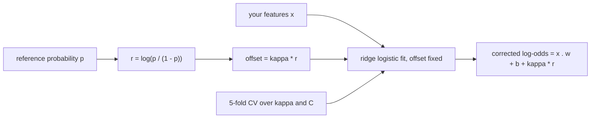
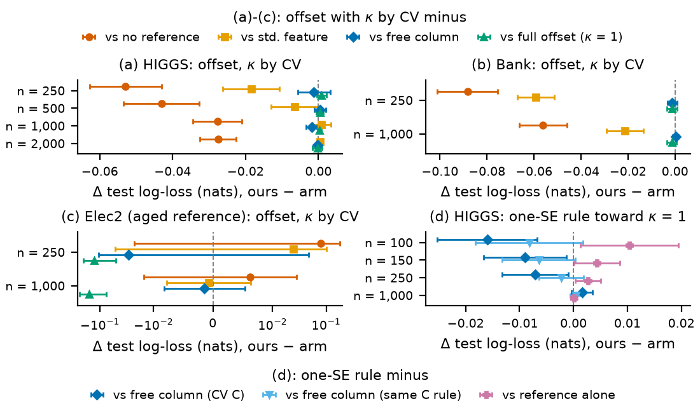
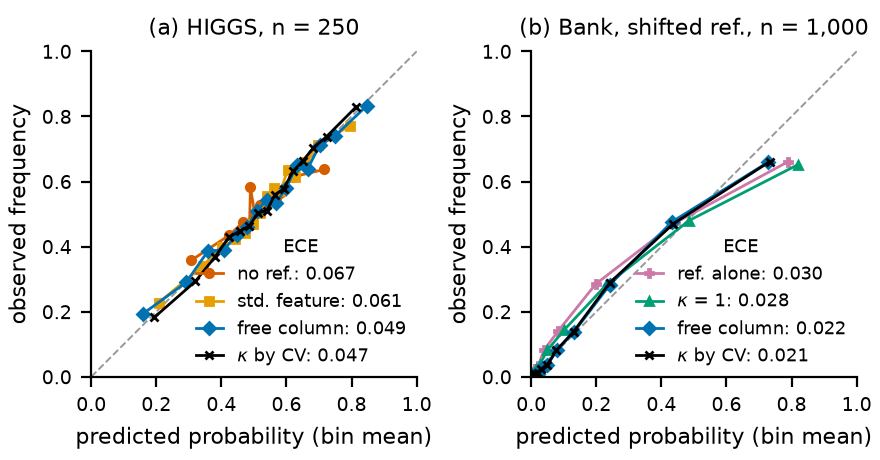

# anchorlogit: logistic regression that starts from a probability you already have

<p align="center">
  <a href="https://x.com/tr4m0ryp"></a>
</p>
<p align="center">
  <a href="paper/anchorlogit.pdf"></a>
</p>

Gives scikit-learn's `LogisticRegression` the per-sample `offset=` it lacks, **exact to 1.2e-8** against statsmodels
and glum, with a fix for the Newton line search, and uses it to fit only the correction on top of a probability you
already have. On loss it **ties the obvious alternative**, the reference entered as a nearly free column: ahead
beyond 2 SE in 1 of 8 benchmark cells, behind in none. What the offset buys is an exact fit, one fewer fitted
coefficient and a ridge that shrinks towards the reference instead of towards zero. The large gains (-0.053 nats on
HIGGS, -0.088 on Bank at 250 rows) are against a model without the reference, and the free column gets them too.

```bash
pip install git+https://github.com/tr4m0ryp/anchorlogit
```

```python
from anchorlogit import AnchoredLogisticRegression
# column -1 of X is a reference probability from a model that never saw these labels
model = AnchoredLogisticRegression(anchor=-1, kappa="cv", C=1.0).fit(X, y)
p = model.predict_proba(X_new)[:, 1]
print(model.kappa_, model.anchor_coef_)   # how much of the reference was kept
```

<details>
<summary>How the model works, in plain words</summary>

Picture a weather service that already gives a rain probability for every day. You have a few hundred days of your
own notes, say, whether your garden actually got wet, plus some local measurements the service does not use. You do
not want to throw the service away and learn rain from scratch on 300 days. You want to keep its forecast and learn
only how your local measurements should nudge it.

Logistic regression turns a weighted sum of features into a probability. The sum lives on the **log-odds** scale
(the logit), where 0 means 50 %, +2 means about 88 % and -2 about 12 %. A probability you already have can be moved
onto that same scale with `log(p / (1 - p))`.

An **offset** is a number added to that sum for each row, with its weight fixed in advance instead of learned. Put
the reference's log-odds in as the offset and the model starts exactly at the reference. Every learned weight then
describes only a correction: "on days with this local reading, shift the forecast up a bit". With no useful
features, the model stays at the reference.

Why not just add the reference as one more feature? You can, but ridge regularisation (a penalty that pulls weights
towards zero to fight overfitting on small data) also pulls the weight on the reference towards zero. On 250 rows
that throws away part of your best input. The offset avoids that, because its weight is not a parameter at all.
Multiplying the column by 100 so the penalty barely touches its weight avoids it too, and in our benchmarks did
about as well; the offset does it exactly and with one fewer coefficient.

Sometimes the reference is too confident or slightly off. So the package uses a **fraction** `kappa` of the
reference's log-odds as the offset, picked by cross-validation from 0, 0.1, 0.25, 0.5, 0.75 and 1. `kappa = 1` is the
classical offset; `kappa = 0` ignores the reference. A more general knob, the **anchor strength**, lets the weight on
the reference move but pulls it towards `kappa` instead of towards zero.

One rule matters more than any setting: the reference for a training row must not have seen that row's label. If you
fit the reference on the same rows, the package **cross-fits** it: each row's reference comes from a fit on the other
folds. Skipping that leaks the labels and made log-loss worse by 0.06 to 0.53 nats in our runs.

What we found: starting from the reference beats ignoring it by a lot on small samples on HIGGS and Bank (not on the
drifting Elec2 stream), which is expected. Against the honest rival, the reference entered as a feature whose weight
is left almost free, it ties. The offset never lost that comparison and its fit is exact, so it is a safe default,
not a free gain.



</details>

## The method

For row $`i`$ with features $`x_i`$, label $`y_i \in \{0, 1\}`$, sample weight $`s_i`$ and a given offset $`o_i`$
(data, never fitted), the fit is

```math
\eta_i = x_i^\top w + b + o_i, \qquad
\min_{w,b}\; C \sum_{i=1}^{n} s_i\, \ell(y_i, \eta_i) + \tfrac{1}{2}\lVert w\rVert^2, \qquad
\ell(y, \eta) = \log(1 + e^{\eta}) - y\eta
```

With a reference probability $`p_i`$ and $`r_i = \operatorname{logit}(p_i)`$ (clipped to $`[10^{-3}, 1 - 10^{-3}]`$),
the offset is a fraction of the reference:

```math
o_i = \kappa\, r_i, \qquad \kappa \in \{0, 0.1, 0.25, 0.5, 0.75, 1\}
```

chosen jointly with $`C`$ by 5-fold cross-validated log-loss. $`\kappa = 1`$ is the classical GLM offset
(McCullagh and Nelder 1989). The general form frees the coefficient $`\beta`$ on $`r`$ but pulls it towards
$`\kappa`$ with an anchor strength $`\lambda`$:

```math
J(w, b, \beta) = C \sum_i s_i\, \ell\bigl(y_i,\; x_i^\top w + b + \beta r_i\bigr)
  + \tfrac{1}{2}\lVert w\rVert^2 + \tfrac{1}{2}\lambda(\beta - \kappa)^2
```

$`\lambda = \infty`$ is the fixed offset, $`\lambda = 0`$ the reference as a free column. For $`0 < \lambda < \infty`$
the minimiser of $`J`$ is the offset fit with $`o_i = \kappa r_i`$ plus one extra ridge column $`r_i / \sqrt{\lambda}`$
with weight $`u`$, mapped back by $`\beta = \kappa + u / \sqrt{\lambda}`$ (Lemma 1, proof in the
[paper](paper/anchorlogit.pdf), Appendix A). So `offset=` is all a solver needs.

The package ships two solvers on the same loss: L-BFGS-B (dense or sparse) and a damped Newton step with Armijo
backtracking. In the Newton line search the trial log-odds are $`\eta(w + t d) = \eta(w) + t\, X d`$; the direction
term must be built without the offset, or the offset counts twice per step. scikit-learn's `newton-cholesky` line
search builds that term with the same helper that would add the offset, so it stalls or falls back to lbfgs once an
offset exists; `patches/scikit-learn-offset.patch` fixes it as part of an `offset=` patch for scikit-learn issue [#24614](https://github.com/scikit-learn/scikit-learn/issues/24614)
(232 added and 19 removed library lines, 318 lines of tests, 61 new upstream tests pass on 1.9.1).

**API:** `OffsetLogisticRegression().fit(X, y, offset=o)` and `predict_proba(X, offset=o)` for a raw offset;
`AnchoredLogisticRegression(anchor=..., kappa="cv", anchor_strength=np.inf)` where `anchor` is a column of `X`, a
fitted classifier, an unfitted classifier (cross-fitted), a `CrossFitReference` or a callable; `logit_of`,
`FallbackReference` and `CrossFitReference` build reference log-odds. When the installed scikit-learn already accepts
`offset=` (`anchorlogit.sklearn_supports_offset()`), the package uses it.

## Results

Three public OpenML datasets, each with a different kind of reference. **HIGGS:** gradient boosting on the 21
low-level columns, fitted once on 60,000 disjoint rows; the ridge sees all 28 columns. **Bank Marketing:** gradient
boosting on every column, fitted on a disjoint half, so the features add nothing (the expected null). **Elec2:** a
time-ordered stream; the reference is fitted before each origin with a 48-row embargo, so it ages, and the test set
is the next week. Every arm sees the same rows, features and folds, and $`C`$ runs over the same 11-value grid.

Arms: **a1** pristine `LogisticRegressionCV` without the reference; **a2** the reference alone; **a3** $`r`$ as a
standardised feature; **a4** the same column times 100 (nearly unpenalised, $`\lambda \approx 0`$); **a5** offset
with $`\kappa = 1`$; **a6** offset with $`(\kappa, C)`$ by CV (ours). The paired difference over repeat $`j`$'s test
rows is

```math
d_j = \frac{1}{|T_j|}\sum_{i \in T_j} \bigl[\ell(y_i, \eta^{\mathrm{ours}}_i) - \ell(y_i, \eta^{a}_i)\bigr],
\qquad \bar d = \frac{1}{R}\sum_j d_j, \qquad \mathrm{SE} = \frac{\operatorname{sd}(d_1, \dots, d_R)}{\sqrt{R}}
```

over disjoint repeats (HIGGS 10, Bank 8, Elec2 12), so the SE includes the training draw. Negative favours ours; a
win needs $`|\bar d| > 2\,\mathrm{SE}`$ (bold).

**Test log-loss (nats) and a6 minus each arm (SE):**

| data, n | a1 | a2 | a3 | a4 | a5 | a6 | vs a1 | vs a3 | vs a4 | vs a5 |
|---|---|---|---|---|---|---|---|---|---|---|
| HIGGS 250 | .6839 | .6275 | .6494 | .6321 | .6300 | .6309 | **-.0529 (.0044)** | **-.0185 (.0034)** | -.0012 (.0020) | +.0009 (.0006) |
| HIGGS 500 | .6722 | .6275 | .6357 | .6286 | .6287 | .6291 | **-.0431 (.0046)** | **-.0066 (.0029)** | +.0005 (.0007) | +.0004 (.0004) |
| HIGGS 1,000 | .6536 | .6275 | .6250 | .6278 | .6257 | .6259 | **-.0277 (.0030)** | +.0009 (.0011) | **-.0019 (.0006)** | +.0002 (.0002) |
| HIGGS 2,000 | .6461 | .6275 | .6182 | .6187 | .6189 | .6186 | **-.0276 (.0022)** | +.0004 (.0003) | -.0002 (.0002) | -.0003 (.0006) |
| Bank 250 | .2920 | .1991 | .2629 | .2050 | .2051 | .2038 | **-.0882 (.0054)** | **-.0591 (.0033)** | -.0012 (.0008) | -.0013 (.0009) |
| Bank 1,000 | .2548 | .1991 | .2199 | .1984 | .2000 | .1986 | **-.0561 (.0043)** | **-.0213 (.0033)** | +.0002 (.0005) | -.0014 (.0009) |
| Elec2 250 | 1.138 | .9089 | 1.193 | 1.247 | 1.345 | 1.218 | +.0793 (.0465) | +.024 (.035) | -.0290 (.0346) | **-.1272 (.0349)** |
| Elec2 1,000 | .6864 | .9089 | .6933 | .6940 | .8505 | .6926 | +.0062 (.0098) | -.0007 (.0032) | -.0014 (.0031) | **-.1580 (.0372)** |

**What the table says:**
- **Against no reference (a1):** a win in 6 of 8 cells, from -0.053 at n = 250 to -0.028 at n = 2,000 on HIGGS; it
  fails on Elec2, where the aged reference is confidently wrong in a few drift weeks. The free column a4 is within
  0.002 of the offset in every one of those cells, so this shows the reference helps, not the offset.
- **Against the penalised column (a3):** a win at small n (HIGGS 250 and 500, Bank 250 and 1,000), because the ridge
  shrinks the reference's weight; a tie once n >= 1,000 on HIGGS and on Elec2.
- **Against the nearly free column (a4):** a tie. One win (HIGGS 1,000, -0.0019, SE 0.0006), no losses.
- **The fraction kappa:** it matters only where the reference is miscalibrated. On HIGGS CV picks kappa = 1 in 8 or 9
  of 10 draws at every n; on Elec2 the median is 0.25 and a6 beats the full offset by 0.158 (SE 0.037) at n = 1,000. A Bank
  reference trained only on younger clients gives median kappa 0.75 and beats kappa = 1 by 0.0077 (SE 0.0012), still
  a tie with the free column.

**Ablations on HIGGS (a6 minus arm, SE; positive means the arm is better):**

| n | anchored (kappa, lambda, C by CV) | no source columns | reference refit in-sample | LightGBM started at kappa r |
|---|---|---|---|---|
| 250 | -.0020 (.0021) | +.0030 (.0026) | **-.5133 (.0358)** | **-.0119 (.0052)** |
| 500 | +.0002 (.0010) | **+.0062 (.0019)** | **-.3737 (.0218)** | **+.0210 (.0021)** |
| 1,000 | -.0005 (.0003) | **+.0089 (.0014)** | **-.1717 (.0044)** | **+.0387 (.0026)** |
| 2,000 | +.0000 (.0000) | **+.0049 (.0016)** | **-.0827 (.0032)** | **+.0473 (.0032)** |

**Exactness (largest absolute difference):**

| check | cases | coefficients | log-odds |
|---|---|---|---|
| offset fit vs statsmodels GLM with offset | 12 | 8.3e-9 | 3.6e-8 |
| offset fit vs glum with offset | 18 | 1.2e-8 | 4.4e-8 |
| zero offset vs stock scikit-learn | 9 | 1.9e-8 | not stored |
| Lemma 1: offset + column vs direct minimisation of J | 18 | 2.5e-10 | 3.3e-9 |

**One-SE rule (post-hoc, the only kept variant):** among all $`(\kappa, C)`$ within one fold-SE of the best CV loss,
take the largest $`\kappa`$, then the strongest ridge. On the draws it was chosen on it beat the free column under the
same rule at n = 150 (-0.0064, SE 0.0030), not quite at n = 100 (-0.0082, SE 0.0044). On 5 fresh HIGGS draws the order
flipped: a win at n = 100 (-0.0103, SE 0.0050) and a tie at n = 150 (-0.0021, SE 0.0016). It lost to the reference
alone at every n <= 250, on both sets of draws, and it picks kappa = 1 in every draw, so it is the classical offset
with a conservative ridge.



*Offset minus each rival, 95 % intervals from the between-repeat SE; below zero favours the offset. Panel (c) has a
symmetric log axis.*



*Reliability on pooled test rows, 15 equal-mass bins: the offset is about as well calibrated as the free column (ECE
within 0.005 of it in every main cell).*

## When to use it

- **You have a reference probability for every row and a few hundred labels:** use `AnchoredLogisticRegression`
  with `kappa="cv"`. You get the free-column result without having to know the scaling trick, an exact fit, and a
  `kappa_` that tells you how much the reference was trusted.
- **The reference was fitted on your training rows:** pass the unfitted classifier as `anchor` (or a
  `CrossFitReference`) so it is cross-fitted. Never use in-sample reference values.
- **You need a classical offset in scikit-learn** (exposure, known coefficients, a prior correction):
  `OffsetLogisticRegression(...).fit(X, y, offset=o)`.
- **You have more than a few hundred rows:** a nonlinear residual (LightGBM started at `kappa * r`) beat every linear
  arm on HIGGS from n = 500 on (tested on HIGGS only).

## Limits

- **The headline is a tie** with the reference as a nearly free column (1 win in 8 cells, 1 under a two-stage
  bootstrap SE). Scaling one column up does about as well; the offset's value is exactness, one fewer coefficient and
  its shrinkage target, not lower loss.
- **No win over the no-reference model on Elec2** (+0.079, SE 0.047 at n = 250). A Platt-recalibrated reference does
  far better there (0.635 against our 1.218 at n = 250, a tie only by the large SE), so `kappa < 1` is a coarse fix for a
  reference wrong in slope and level.
- **The one-SE rule is post-hoc** and held on fresh draws at one of two sizes, by about 2 SE: weak evidence.
- **Binary only.** The scikit-learn patch also adds `offset=` to the Poisson, Gamma and Tweedie regressors; we claim
  nothing for them beyond the patch's tests.
- **Narrow evidence:** three datasets, all with gradient-boosting references, n <= 2,000, 8 to 12 repeats. The Elec2
  windows share an expanding reference history, so their SE is optimistic.
- **Cut for budget:** ACS Income, n > 2,000 and 30 repeats. Every cut and attempt is listed in
  [`bench/results/SCOPE.md`](bench/results/SCOPE.md).

## Reproduce

Python 3.12.3, NumPy 2.5.4, SciPy 1.18.1, scikit-learn 1.9.1, LightGBM 4.7.0, statsmodels 0.15.0, glum 3.4.1, CPU
only, 2 threads per process (3.5 h summed). OpenML data are cached in `$ANCHORLOGIT_DATA` (default
`../_data/openml`) and per-row test log-odds in `$ANCHORLOGIT_BENCH_RAW` (default `../_data/anchorlogit_bench`), never
inside the repository.

```bash
git clone https://github.com/tr4m0ryp/anchorlogit && cd anchorlogit
pip install -e ".[dev]" lightgbm pandas matplotlib
pytest                                         # 295 tests with the patch, stock skips the patch-only ones
bash patches/check_patch.sh python             # apply the scikit-learn patch to a copy and run its tests
bash bench/run_all.sh                          # HIGGS, Elec2, Bank
bash bench/run_variants.sh                     # one-SE rule, its controls, strong and shifted references
python -m bench.summarize                      # every table
OMP_NUM_THREADS=2 python paper/results/confirm_1se.py   # fresh-draw check of the one-SE rule
python paper/results/twins.py                  # statsmodels / glum / stock equivalence
python paper/results/recompute.py              # means and SEs from the per-row log-odds
python paper/results/make_numbers.py && python paper/results/make_extra.py   # every number in the paper
python paper/figures/make.py                   # the figures
python examples/quickstart.py                  # one-minute synthetic demo
```

## Cite

```bibtex
@misc{ouallaf2026anchorlogit,
  author       = {Ouallaf, Moussa},
  organization = {Husimi.ai},
  title        = {A per-sample offset for scikit-learn logistic regression},
  year         = {2026},
  howpublished = {\url{https://github.com/tr4m0ryp/anchorlogit}},
  note         = {Software: anchorlogit 0.1.0}
}
```

## License

anchorlogit is **source-available**, licensed under the [PolyForm Noncommercial License 1.0.0](./LICENSE), **not** an
OSI open-source license.

- **You may** use, modify, fork, and share anchorlogit freely for any **noncommercial** purpose, as long as you keep
  the copyright and `Required Notice:` lines (see [`NOTICE`](./NOTICE)) and credit *"anchorlogit by Keygraph, Inc."*
- **You may not** sell it, bundle it into a paid product, or run it as a paid/hosted service **without a commercial
  license**.
- **Exception:** [`patches/scikit-learn-offset.patch`](patches/scikit-learn-offset.patch) changes scikit-learn and
  contains its source lines, so it stays under scikit-learn's **BSD 3-Clause License**
  ([`patches/LICENSE-scikit-learn`](patches/LICENSE-scikit-learn)), Copyright (c) 2007-2026 The scikit-learn
  developers. The package itself contains no code derived from scikit-learn; it only imports it.

Copyright (c) 2026 Keygraph, Inc. Commercial licensing enquiries: moussa@husimi.ai (see [`NOTICE`](./NOTICE)).
